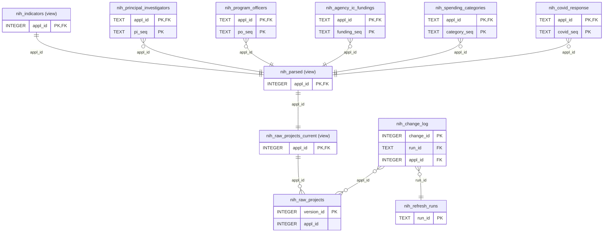

# Data model: NIH RePORTER harvest (nationwide)

Generated by `.venv/bin/python3 tools/make_data_model.py` at 2026-10-28 17:15 UTC from the SQLite catalog of `data/nih_harvester.db` and `tools/relationships.yml`. Don't edit by hand: change `relationships.yml` or the database and regenerate.

Every record is keyed by `appl_id`: one per fiscal year a project is active. `project_num` and `core_project_num` group those years into a project, and collapsing to the latest year per project happens in views, never at load time. `nih_raw_projects` keeps every version of every record; `nih_raw_projects_current` is the current one. The database declares no foreign keys, so the joins below come from `tools/relationships.yml` and are checked against the data each time this is generated.

In the diagram, PK marks the columns that identify a row (the object's grain; only `nih_raw_projects.version_id`, `nih_change_log.change_id` and `nih_refresh_runs.run_id` are declared keys) and FK marks a join column on the `from` side. Views are labelled `(view)`. Only key and join columns are drawn; every column is in the data dictionary below. `untyped` means the column has no declared type: a view's computed column, or a child-table column built from one.

## Relationships, checked against the data

Orphan rows: rows whose join columns are all set but match nothing on the `to` side. Unique-side dups: key values that repeat on a side the cardinality says is unique.

| From | To | Card. | Meaning | Rows | NULL join | Orphan rows (keys) | Unique-side dups | Holds |
| --- | --- | --- | --- | ---: | ---: | ---: | ---: | --- |
| `nih_raw_projects_current.appl_id` | `nih_raw_projects.appl_id` | 1:N | The current version of a record, among all its versions (is_current = 1). | 2,983,713 | 0 | 0 (0) | 0 | yes |
| `nih_parsed.appl_id` | `nih_raw_projects_current.appl_id` | 1:1 | raw_json unpacked into columns. | 2,983,713 | 0 | 0 (0) | 0 | yes |
| `nih_indicators.appl_id` | `nih_parsed.appl_id` | 1:1 | nih_parsed plus the multi-year-funding columns. | 2,983,713 | 0 | 0 (0) | 0 | yes |
| `nih_principal_investigators.appl_id` | `nih_parsed.appl_id` | N:1 | One row per PI listed on the record. appl_id is text here, an integer in nih_parsed. | 3,245,879 | 0 | 0 (0) | 0 | yes |
| `nih_program_officers.appl_id` | `nih_parsed.appl_id` | N:1 | One row per program officer on the record. | 1,634,048 | 0 | 0 (0) | 0 | yes |
| `nih_agency_ic_fundings.appl_id` | `nih_parsed.appl_id` | N:1 | One row per funding institute on the record. | 2,790,066 | 0 | 0 (0) | 0 | yes |
| `nih_spending_categories.appl_id` | `nih_parsed.appl_id` | N:1 | One row per spending category on the record. | 7,435,248 | 0 | 0 (0) | 0 | yes |
| `nih_covid_response.appl_id` | `nih_parsed.appl_id` | N:1 | One row per COVID response code on the record. | 4,596 | 0 | 0 (0) | 0 | yes |
| `nih_change_log.appl_id` | `nih_raw_projects.appl_id` | N:N | Changes detected to a record. Join all versions, not the current view, so REMOVED rows match. | 110,953 | 0 | 0 (0) | n/a | yes |
| `nih_change_log.run_id` | `nih_refresh_runs.run_id` | N:1 | The weekly load that detected the change. | 110,953 | 0 | 0 (0) | 0 | yes |

## Keys

| Object | Key (grain) | Rows | NULL keys | Duplicate keys |
| --- | --- | ---: | ---: | ---: |
| `nih_raw_projects` | version_id | 3,069,773 | 0 | 0 |
| `nih_raw_projects_current` | appl_id | 2,983,713 | 0 | 0 |
| `nih_parsed` | appl_id | 2,983,713 | 0 | 0 |
| `nih_indicators` | appl_id | 2,983,713 | 0 | 0 |
| `nih_principal_investigators` | appl_id, pi_seq | 3,245,879 | 0 | 0 |
| `nih_program_officers` | appl_id, po_seq | 1,634,048 | 0 | 0 |
| `nih_agency_ic_fundings` | appl_id, funding_seq | 2,790,066 | 0 | 0 |
| `nih_spending_categories` | appl_id, category_seq | 7,435,248 | 0 | 0 |
| `nih_covid_response` | appl_id, covid_seq | 4,596 | 0 | 0 |
| `nih_change_log` | change_id | 110,953 | 0 | 0 |
| `nih_refresh_runs` | run_id | 2 | 0 | 0 |

## Identifiers declared as numbers

Ids, codes, sequences and fiscal years are text in the child tables. These columns have such a name and a numeric declared type:

| Object | Column | Type |
| --- | --- | --- |
| `nih_change_log` | change_id | INTEGER |
| `nih_change_log` | appl_id | INTEGER |
| `nih_change_log` | fiscal_year | INTEGER |
| `nih_indicators` | appl_id | INTEGER |
| `nih_indicators` | fiscal_year | INTEGER |
| `nih_parsed` | appl_id | INTEGER |
| `nih_parsed` | fiscal_year | INTEGER |
| `nih_raw_projects` | version_id | INTEGER |
| `nih_raw_projects` | appl_id | INTEGER |
| `nih_raw_projects` | fiscal_year | INTEGER |
| `nih_raw_projects_current` | version_id | INTEGER |
| `nih_raw_projects_current` | appl_id | INTEGER |
| `nih_raw_projects_current` | fiscal_year | INTEGER |

## Data dictionary

### `nih_agency_ic_fundings` (table)

| Column | Type |
| --- | --- |
| appl_id | TEXT |
| funding_seq | TEXT |
| funding_fy | TEXT |
| ic_code | (none) |
| ic_abbreviation | (none) |
| ic_name | (none) |
| ic_total_cost | (none) |
| ic_direct_cost | (none) |
| ic_indirect_cost | (none) |
| project_num | TEXT |
| core_project_num | TEXT |
| fiscal_year | TEXT |
| project_title | (none) |
| contact_pi_name | (none) |
| activity_code | (none) |
| award_type | (none) |
| agency_ic_admin_abbreviation | (none) |
| organization_org_name | (none) |
| organization_org_ipf_code | TEXT |
| organization_org_state | (none) |
| organization_dept_type | (none) |
| is_active | (none) |
| project_start_date | (none) |
| project_end_date | (none) |

### `nih_change_log` (table)

| Column | Type |
| --- | --- |
| change_id | INTEGER |
| run_id | TEXT |
| detected_at | TEXT |
| appl_id | INTEGER |
| project_num | TEXT |
| fiscal_year | INTEGER |
| change_type | TEXT |
| field_name | TEXT |
| old_value | TEXT |
| new_value | TEXT |
| found_by | TEXT |

### `nih_covid_response` (table)

| Column | Type |
| --- | --- |
| appl_id | TEXT |
| covid_seq | TEXT |
| covid_response_code | (none) |
| project_num | TEXT |
| core_project_num | TEXT |
| fiscal_year | TEXT |
| project_title | (none) |
| contact_pi_name | (none) |
| activity_code | (none) |
| award_type | (none) |
| agency_ic_admin_abbreviation | (none) |
| organization_org_name | (none) |
| organization_org_ipf_code | TEXT |
| organization_org_state | (none) |
| organization_dept_type | (none) |
| is_active | (none) |
| project_start_date | (none) |
| project_end_date | (none) |

### `nih_indicators` (view)

Reads: `nih_parsed`.

| Column | Type |
| --- | --- |
| appl_id | INTEGER |
| project_num | TEXT |
| core_project_num | TEXT |
| fiscal_year | INTEGER |
| project_title | (none) |
| activity_code | (none) |
| agency_code | (none) |
| award_type | (none) |
| award_amount | (none) |
| direct_cost_amt | (none) |
| indirect_cost_amt | (none) |
| cfda_code | (none) |
| cong_dist | (none) |
| contact_pi_name | (none) |
| funding_mechanism | (none) |
| mechanism_code_dc | (none) |
| opportunity_number | (none) |
| project_detail_url | (none) |
| project_serial_num | (none) |
| subproject_id | (none) |
| arra_funded | (none) |
| is_active | (none) |
| is_new | (none) |
| award_notice_date | (none) |
| budget_start | (none) |
| budget_end | (none) |
| project_start_date | (none) |
| project_end_date | (none) |
| date_added | (none) |
| agency_ic_admin_code | (none) |
| agency_ic_admin_abbreviation | (none) |
| agency_ic_admin_name | (none) |
| organization_org_name | (none) |
| organization_org_city | (none) |
| organization_org_state | (none) |
| organization_org_country | (none) |
| organization_dept_type | (none) |
| organization_primary_duns | (none) |
| organization_primary_uei | (none) |
| organization_org_ipf_code | (none) |
| organization_org_zipcode | (none) |
| organization_type_name | (none) |
| organization_type_code | (none) |
| geo_lat | (none) |
| geo_lon | (none) |
| project_num_split_activity_code | (none) |
| project_num_split_ic_code | (none) |
| project_num_split_serial_num | (none) |
| project_num_split_support_year | (none) |
| full_study_section_code | (none) |
| full_study_section_name | (none) |
| principal_investigators_json | (none) |
| program_officers_json | (none) |
| agency_ic_fundings_json | (none) |
| spending_categories_json | (none) |
| covid_response_json | (none) |
| abstract_text | (none) |
| phr_text | (none) |
| terms | (none) |
| pref_terms | (none) |
| spending_categories_desc | (none) |
| budget_duration_days | INT |
| project_duration_days | INT |
| is_myf | (none) |
| funding_classification | (none) |
| fiscal_year_oct1 | (none) |

### `nih_parsed` (view)

Reads: `nih_indicators`, `nih_raw_projects_current`.

| Column | Type |
| --- | --- |
| appl_id | INTEGER |
| project_num | TEXT |
| core_project_num | TEXT |
| fiscal_year | INTEGER |
| project_title | (none) |
| activity_code | (none) |
| agency_code | (none) |
| award_type | (none) |
| award_amount | (none) |
| direct_cost_amt | (none) |
| indirect_cost_amt | (none) |
| cfda_code | (none) |
| cong_dist | (none) |
| contact_pi_name | (none) |
| funding_mechanism | (none) |
| mechanism_code_dc | (none) |
| opportunity_number | (none) |
| project_detail_url | (none) |
| project_serial_num | (none) |
| subproject_id | (none) |
| arra_funded | (none) |
| is_active | (none) |
| is_new | (none) |
| award_notice_date | (none) |
| budget_start | (none) |
| budget_end | (none) |
| project_start_date | (none) |
| project_end_date | (none) |
| date_added | (none) |
| agency_ic_admin_code | (none) |
| agency_ic_admin_abbreviation | (none) |
| agency_ic_admin_name | (none) |
| organization_org_name | (none) |
| organization_org_city | (none) |
| organization_org_state | (none) |
| organization_org_country | (none) |
| organization_dept_type | (none) |
| organization_primary_duns | (none) |
| organization_primary_uei | (none) |
| organization_org_ipf_code | (none) |
| organization_org_zipcode | (none) |
| organization_type_name | (none) |
| organization_type_code | (none) |
| geo_lat | (none) |
| geo_lon | (none) |
| project_num_split_activity_code | (none) |
| project_num_split_ic_code | (none) |
| project_num_split_serial_num | (none) |
| project_num_split_support_year | (none) |
| full_study_section_code | (none) |
| full_study_section_name | (none) |
| principal_investigators_json | (none) |
| program_officers_json | (none) |
| agency_ic_fundings_json | (none) |
| spending_categories_json | (none) |
| covid_response_json | (none) |
| abstract_text | (none) |
| phr_text | (none) |
| terms | (none) |
| pref_terms | (none) |
| spending_categories_desc | (none) |

### `nih_principal_investigators` (table)

| Column | Type |
| --- | --- |
| appl_id | TEXT |
| pi_seq | TEXT |
| pi_profile_id | TEXT |
| pi_first_name | (none) |
| pi_middle_name | (none) |
| pi_last_name | (none) |
| pi_full_name | (none) |
| pi_title | (none) |
| is_contact_pi | (none) |
| project_num | TEXT |
| core_project_num | TEXT |
| fiscal_year | TEXT |
| project_title | (none) |
| contact_pi_name | (none) |
| activity_code | (none) |
| award_type | (none) |
| agency_ic_admin_abbreviation | (none) |
| organization_org_name | (none) |
| organization_org_ipf_code | TEXT |
| organization_org_state | (none) |
| organization_dept_type | (none) |
| is_active | (none) |
| project_start_date | (none) |
| project_end_date | (none) |

### `nih_program_officers` (table)

| Column | Type |
| --- | --- |
| appl_id | TEXT |
| po_seq | TEXT |
| po_first_name | (none) |
| po_middle_name | (none) |
| po_last_name | (none) |
| po_full_name | (none) |
| project_num | TEXT |
| core_project_num | TEXT |
| fiscal_year | TEXT |
| project_title | (none) |
| contact_pi_name | (none) |
| activity_code | (none) |
| award_type | (none) |
| agency_ic_admin_abbreviation | (none) |
| organization_org_name | (none) |
| organization_org_ipf_code | TEXT |
| organization_org_state | (none) |
| organization_dept_type | (none) |
| is_active | (none) |
| project_start_date | (none) |
| project_end_date | (none) |

### `nih_raw_projects` (table)

| Column | Type |
| --- | --- |
| version_id | INTEGER |
| appl_id | INTEGER |
| project_num | TEXT |
| core_project_num | TEXT |
| fiscal_year | INTEGER |
| raw_json | TEXT |
| row_hash | TEXT |
| valid_from | TEXT |
| valid_to | TEXT |
| is_current | INTEGER |

### `nih_raw_projects_current` (view)

Reads: `nih_raw_projects`.

| Column | Type |
| --- | --- |
| version_id | INTEGER |
| appl_id | INTEGER |
| project_num | TEXT |
| core_project_num | TEXT |
| fiscal_year | INTEGER |
| raw_json | TEXT |
| row_hash | TEXT |
| valid_from | TEXT |
| valid_to | TEXT |
| is_current | INTEGER |

### `nih_refresh_runs` (table)

| Column | Type |
| --- | --- |
| run_id | TEXT |
| loaded_at | TEXT |
| records_pulled | INTEGER |
| new_count | INTEGER |
| changed_count | INTEGER |
| removed_count | INTEGER |
| delta_file | TEXT |
| delta_sha256 | TEXT |

### `nih_spending_categories` (table)

| Column | Type |
| --- | --- |
| appl_id | TEXT |
| category_seq | TEXT |
| spending_category_id | TEXT |
| spending_category_name | (none) |
| project_num | TEXT |
| core_project_num | TEXT |
| fiscal_year | TEXT |
| project_title | (none) |
| contact_pi_name | (none) |
| activity_code | (none) |
| award_type | (none) |
| agency_ic_admin_abbreviation | (none) |
| organization_org_name | (none) |
| organization_org_ipf_code | TEXT |
| organization_org_state | (none) |
| organization_dept_type | (none) |
| is_active | (none) |
| project_start_date | (none) |
| project_end_date | (none) |
